# Nội dung tổng thể Website: BYRA Technologics — Giải pháp Smart Factory (MES, Số hóa & Truy xuất nguồn gốc)

> **Tài liệu này là nguồn nội dung chuẩn (Master Copy & Content Architecture)** cho trang landing page [SmartFactory.html](file:///d:/Project/WebSite/SmartFactory.html) và các ấn phẩm truyền thông đi kèm của thương hiệu **BYRA Technologics**.

---

## 1. Định vị nội dung & Chân dung khách hàng (Target Audience)

### 1.1. Tuyên ngôn giá trị cốt lõi (Core Value Proposition)
**BYRA Technologics** cung cấp nền tảng điều hành sản xuất thực thi (MES/MOM), số hóa quy trình không giấy tờ (Paperless), giám sát thiết bị IIoT/OEE và truy xuất nguồn gốc chuẩn GS1 — kết nối xuyên suốt từ thiết bị hiện trường (PLC, cảm biến, máy quét) đến hệ thống quản trị doanh nghiệp (ERP).

### 1.2. Đối tượng độc giả mục tiêu (B2B Personas)
| Nhóm độc giả | Mối quan tâm chính | Thông điệp chạm đúng nhu cầu |
| :--- | :--- | :--- |
| **Ban Giám đốc / Chủ doanh nghiệp (CEO, COO)** | Tối ưu chi phí, minh bạch năng lực sản xuất thực, ROI rõ ràng, mở rộng quy mô nhà máy. | Nền tảng mô-đun: bắt đầu nhỏ từ 1 chuyền thí điểm, đo lường hiệu quả rõ ràng trước khi nhân rộng toàn nhà máy. |
| **Giám đốc Nhà máy / Quản đốc Sản xuất (Plant / Production Manager)** | Tiến độ đơn hàng, tồn kho bán thành phẩm (WIP), hiệu suất máy (OEE), giảm thời gian chết, bỏ báo cáo giấy trễ hạn. | Ghi nhận sản lượng – dừng máy tự động theo thời gian thực; giảm 90% thời gian làm báo cáo cuối ca; tăng 15–25% OEE. |
| **Trưởng bộ phận QA/QC & Tuân thủ (Quality Manager)** | Truy xuất nguồn gốc khi khiếu nại/thu hồi, vượt qua kỳ audit của khách hàng quốc tế (EU, Mỹ, Nhật), kiểm soát SPC/eBR. | Truy xuất xuôi/ngược theo lô và serial dưới 30 giây chuẩn GS1 & TCVN 12850:2019; khóa lô tự động khi phát hiện bất thường. |
| **Trưởng phòng IT / OT / Tự động hóa** | Khả năng tích hợp với ERP hiện hữu (SAP, Oracle, Odoo...), kết nối máy đời cũ, bảo mật công nghiệp, triển khai linh hoạt. | Kiến trúc chuẩn ISA-95, hỗ trợ OPC UA, MQTT, Modbus, REST API; triển khai On-premise, Cloud hoặc Hybrid; bảo mật theo IEC 62443. |

---

## 2. Cấu trúc thông tin & Sơ đồ trang (Sitemap & Section Flow)

```mermaid
flowchart LR
    A["0. Topbar & Header<br/>Điều hướng + Mega Menu"] --> B["1. Hero Section<br/>Thông điệp chính & CTA"]
    B --> C["2. Promo Strip<br/>3 phễu chuyển đổi nhanh"]
    C --> D["3. Thách thức (Pain Points)<br/>4 điểm nghẽn tại xưởng"]
    D --> E["4. Bộ giải pháp (6 Mô-đun)<br/>MES · Traceability · OEE · QMS · WMS · CMMS"]
    E --> F["5. Nền tảng & Kiến trúc<br/>Chuẩn ISA-95 (Cấp 0–4)"]
    F --> G["6. Dự án tiêu biểu<br/>Case Studies theo ngành"]
    G --> H["7. Lộ trình triển khai<br/>5 bước: Thí điểm → Nhân rộng"]
    H --> I["8. Năng lực & Tiêu chuẩn<br/>Số liệu & Chứng chỉ quốc tế"]
    I --> J["9. CTA & Footer<br/>Đăng ký khảo sát / Demo"]
```

---

## 3. Nội dung chi tiết từng phần (CopyDeck)

### 3.1. Meta SEO & Thanh tiện ích đầu trang (Topbar & Header)
- **Meta Title:** `BYRA Technologics — Giải pháp Smart Factory: Hệ thống MES, Số hóa & Truy xuất nguồn gốc cho nhà máy`
- **Meta Description:** `BYRA Technologics cung cấp giải pháp nhà máy thông minh: hệ thống điều hành sản xuất MES, số hóa quy trình không giấy tờ, giám sát OEE/IIoT và truy xuất nguồn gốc theo lô, theo serial chuẩn GS1.`
- **Utility Topbar:**
  - Trái: *Giải pháp Smart Factory cho nhà máy Việt Nam — MES · Số hóa · Truy xuất nguồn gốc*
  - Phải: *Hotline: (+84) 000 000 000 · Đăng ký khảo sát miễn phí*
- **Điều hướng chính (Header Nav):**
  1. `Giải pháp` (Mega Menu 4 cột: *Vận hành sản xuất*, *Chất lượng & Truy xuất*, *Theo ngành*, *Box Khảo sát miễn phí*)
  2. `Sản phẩm` (Liên kết trực tiếp sang trang thương mại [`Products.html`](file:///d:/Project/WebSite/Products.html) chuyên về các gói phần mềm đóng gói, IIoT Edge Gateway, trạm HMI/Andon, thiết bị mã vạch PDA/máy in GS1 và cảm biến công nghiệp)
  3. `Nền tảng` (`#platform`)
  4. `Dự án` (`#cases`)
  5. `Triển khai` (`#roadmap`)
  6. `Về chúng tôi` (`#about`)
  - **Nút hành động (Header CTA):** `Đặt lịch demo`

---

### 3.2. Phần mở đầu (Hero Section — `#hero`)
- **Nhãn Eyebrow:** `SMART FACTORY · MES · TRACEABILITY`
- **Tiêu đề chính (H1):** **Số hóa nhà máy, minh bạch từng công đoạn sản xuất**
- **Đoạn mô tả (Lead):**
  > BYRA Technologics kết nối máy móc, con người và dữ liệu trên một nền tảng MES duy nhất — giúp nhà máy theo dõi sản lượng theo thời gian thực, nâng hiệu suất thiết bị (OEE) và truy xuất nguồn gốc mọi lô hàng chỉ trong vài giây.
- **Cụm nút CTA:**
  - CTA Chính: `Khám phá giải pháp →`
  - CTA Phụ: `Khảo sát nhà máy miễn phí`
- **Dải cam kết tin cậy (Trust Bar):**
  - `✓ Chuẩn kiến trúc ISA-95`
  - `✓ Mã hóa GS1 (QR / DataMatrix)`
  - `✓ Tích hợp ERP: SAP, Oracle, Odoo…`

---

### 3.3. Dải chuyển đổi nhanh (Promo Strip)
Ba thẻ hành động nổi ngay dưới Hero nhằm thu hút khách hàng ở các giai đoạn tìm hiểu khác nhau:

| Thẻ | Nhãn (Tag) | Tiêu đề | Mô tả ngắn | CTA |
| :--- | :--- | :--- | :--- | :--- |
| **1** | `Công cụ đánh giá` | **Nhà máy của bạn đang ở cấp độ số hóa nào?** | Trả lời 12 câu hỏi để biết mức độ trưởng thành số (cấp 1–5) và ưu tiên đầu tư phù hợp. | `Làm bài đánh giá →` |
| **2** | `Demo trực tiếp` | **Trải nghiệm MES với dữ liệu dây chuyền thực** | Xem lệnh sản xuất, OEE, cảnh báo dừng máy và hồ sơ lô điện tử chạy trên màn hình xưởng. | `Đặt lịch demo 45 phút →` |
| **3** | `Tài liệu chuyên sâu` | **Cẩm nang truy xuất nguồn gốc cho nhà máy xuất khẩu** | Yêu cầu từ thị trường EU, Mỹ, Nhật và cách đáp ứng bằng mã định danh GS1 + MES. | `Tải cẩm nang (PDF) →` |

---

### 3.4. Thách thức thường gặp tại nhà máy (`#challenges`)
- **Kicker:** `THÁCH THỨC THƯỜNG GẶP`
- **Tiêu đề (H2):** **Nhà máy vẫn đang vận hành bằng giấy, Excel và kinh nghiệm?**
- **Mô tả:** Dữ liệu sản xuất rời rạc khiến ban điều hành ra quyết định chậm, khó chứng minh chất lượng với khách hàng và tốn kém khi xảy ra sự cố.

| Mã | Vấn đề tại xưởng | Hệ lụy thực tế | Giải pháp từ BYRA Technologics |
| :---: | :--- | :--- | :--- |
| **01** | **Báo cáo sản xuất trễ 1–2 ngày** | Số liệu ghi tay cuối ca, nhập lại vào Excel — sai lệch, thiếu và không ai tin hoàn toàn. | `→ MES ghi nhận tự động theo thời gian thực` |
| **02** | **Không biết OEE thực tế** | Thời gian dừng máy, chạy chậm, hàng lỗi bị "ẩn" — năng lực thật của xưởng chưa được khai thác. | `→ Kết nối máy (IIoT) & phân tích tổn thất` |
| **03** | **Truy xuất lô mất hàng giờ** | Khi khách hàng khiếu nại hoặc cần thu hồi, phải lục sổ sách nhiều bộ phận mới khoanh vùng được lô lỗi. | `→ Phả hệ lô (genealogy) tra cứu trong vài giây` |
| **04** | **ERP và xưởng không "nói chuyện"** | Kế hoạch trên ERP không phản ánh tiến độ thực tế dưới xưởng; tồn kho WIP luôn chênh lệch. | `→ Tích hợp hai chiều ERP ⇄ MES ⇄ Máy` |

---

### 3.5. Bộ giải pháp Smart Factory theo mô-đun (`#solutions`)
- **Kicker:** `GIẢI PHÁP`
- **Tiêu đề (H2):** **Bộ giải pháp Smart Factory theo mô-đun**
- **Mô tả:** Bắt đầu từ bài toán cấp thiết nhất, mở rộng dần trên cùng một nền tảng dữ liệu.

#### Mô-đun 1: MES — Điều hành sản xuất (`Manufacturing Execution System`)
- **Tiêu đề:** Điều hành sản xuất theo thời gian thực, không giấy tờ
- **Mô tả:** Số hóa toàn bộ vòng đời lệnh sản xuất: từ kế hoạch nhận từ ERP, điều độ xuống từng chuyền/máy, cấp phát nguyên vật liệu, ghi nhận sản lượng – phế phẩm đến đóng lệnh và hồ sơ lô điện tử.
- **Tính năng cốt lõi:**
  - Lập và điều độ lệnh sản xuất theo năng lực chuyền, ca, công nhân.
  - Hướng dẫn công việc điện tử (eWI) & ghi nhận sản lượng bằng máy quét, tablet.
  - Theo dõi WIP, tiến độ đơn hàng và năng suất lao động tức thời.
  - Hồ sơ lô điện tử (eBR/eDHR) tự động tổng hợp khi đóng lệnh.
- **Chỉ số hiệu quả điển hình:** **`-90%`** thời gian lập báo cáo sản xuất cuối ca, cuối tháng.
- **Điểm nhấn kỹ thuật:** Đồng bộ lệnh, BOM, routing và tồn kho hai chiều với ERP qua REST API / middleware.

#### Mô-đun 2: Truy xuất nguồn gốc (`Traceability & Genealogy`)
- **Tiêu đề:** Truy xuất nguồn gốc theo lô, theo serial chuẩn GS1
- **Mô tả:** Xây dựng phả hệ đầy đủ của sản phẩm: nguyên liệu nào, máy nào, ca nào, ai vận hành, thông số gì, kết quả kiểm tra ra sao và đã giao cho khách hàng nào.
- **Tính năng cốt lõi:**
  - Sinh và in mã định danh GS1: GTIN, SSCC, QR, DataMatrix, GS1-128.
  - Liên kết cha – con: đơn vị → hộp → thùng → pallet (aggregation).
  - Truy xuất xuôi/ngược, khoanh vùng lô ảnh hưởng khi thu hồi.
  - Cổng tra cứu cho người tiêu dùng & chống hàng giả qua QR.
- **Chỉ số hiệu quả điển hình:** **`< 30s`** thời gian khoanh vùng một lô hàng thay vì nhiều giờ tra sổ sách.
- **Điểm nhấn tuân thủ:** Định hướng theo TCVN 12850:2019 và yêu cầu truy xuất của thị trường xuất khẩu.

#### Mô-đun 3: Giám sát máy & OEE (`IIoT · Machine Monitoring`)
- **Tiêu đề:** Giám sát máy và tối ưu hiệu suất thiết bị tổng thể (OEE)
- **Mô tả:** Thu thập tự động trạng thái chạy/dừng, tốc độ, sản lượng và cảnh báo từ PLC, cảm biến — kể cả máy đời cũ — để thấy rõ mọi tổn thất năng lực.
- **Tính năng cốt lõi:**
  - Dashboard OEE theo máy, chuyền, ca: Availability · Performance · Quality.
  - Phân loại nguyên nhân dừng máy, biểu đồ Pareto 6 tổn thất lớn.
  - Màn hình Andon tại xưởng, cảnh báo qua Zalo/Email/SMS.
  - Edge gateway kết nối OPC UA, MQTT, Modbus, Siemens S7…
- **Chỉ số hiệu quả điển hình:** **`+15–25%`** mức cải thiện OEE điển hình sau 6 tháng vận hành.
- **Điểm nhấn kỹ thuật:** Không cần thay máy — bổ sung cảm biến/IO module cho máy chưa có PLC.

#### Mô-đun 4: Quản lý chất lượng (`Quality Management · SPC`)
- **Tiêu đề:** Kiểm soát chất lượng ngay tại công đoạn
- **Mô tả:** Đưa kế hoạch kiểm tra lên tablet, thu thập kết quả đo trực tiếp từ thiết bị và cảnh báo sớm khi quá trình có xu hướng vượt giới hạn kiểm soát.
- **Tính năng cốt lõi:**
  - Kế hoạch kiểm tra IQC – IPQC – OQC số hóa theo sản phẩm, công đoạn.
  - Biểu đồ kiểm soát SPC, Cp/Cpk tự động.
  - Quản lý hàng không phù hợp (NCR), CAPA, 8D.
  - Khóa lô (hold) tự động khi phát hiện bất thường.
- **Chỉ số hiệu quả điển hình:** **`-40%`** tỷ lệ phế phẩm và làm lại nhờ phát hiện sớm sai lệch.
- **Điểm nhấn tuân thủ:** Hỗ trợ ISO 9001, IATF 16949, HACCP/ISO 22000, GMP.

#### Mô-đun 5: Kho & Logistics nội bộ (`Warehouse & Intralogistics — WMS`)
- **Tiêu đề:** Kho nguyên liệu, bán thành phẩm và thành phẩm chính xác
- **Mô tả:** Quản lý vị trí, lô, hạn dùng bằng mã vạch/RFID; đồng bộ cấp phát nguyên vật liệu theo lệnh sản xuất và xuất hàng theo đơn.
- **Tính năng cốt lõi:**
  - Nhập – xuất – chuyển kho bằng thiết bị cầm tay (PDA).
  - Quản lý FIFO/FEFO, hạn sử dụng, vị trí kệ.
  - Cấp phát theo lệnh (kitting) & bổ sung nguyên liệu cho chuyền.
  - Kiểm kê nhanh, đối soát tồn kho với ERP.
- **Chỉ số hiệu quả điển hình:** **`99,8%`** độ chính xác tồn kho sau khi áp dụng quét mã toàn trình.
- **Điểm nhấn thiết bị:** Kết nối máy in nhãn, PDA, RFID, cân điện tử, AGV/AMR.

#### Mô-đun 6: Bảo trì & Số hóa biểu mẫu (`Maintenance · Digital Forms — CMMS`)
- **Tiêu đề:** Bảo trì chủ động và số hóa biểu mẫu xưởng
- **Mô tả:** Lập kế hoạch bảo trì định kỳ dựa trên giờ chạy thực tế từ máy; số hóa checklist, nhật ký ca, biểu mẫu 5S/an toàn thay cho giấy tờ.
- **Tính năng cốt lõi:**
  - Lịch bảo trì phòng ngừa theo thời gian hoặc theo bộ đếm máy.
  - Yêu cầu sửa chữa từ Andon, theo dõi MTTR/MTBF.
  - Quản lý phụ tùng thay thế và chi phí bảo trì.
  - Trình thiết kế biểu mẫu điện tử kéo – thả, chữ ký số, audit trail.
- **Chỉ số hiệu quả điển hình:** **`-30%`** thời gian dừng máy ngoài kế hoạch.
- **Điểm nhấn Paperless:** Toàn bộ biểu mẫu lưu trữ tập trung, tìm kiếm tức thì khi audit.

---

### 3.6. Kiến trúc nền tảng theo chuẩn ISA-95 (`#platform`)
- **Kicker:** `NỀN TẢNG BYRA TECHNOLOGICS`
- **Tiêu đề (H2):** **Kiến trúc mở ISA-95 & Chuẩn tương thích**

| Khối trong tháp thu gọn | Hệ thống / Vai trò | Ghi chú |
| :---: | :--- | :--- |
| **Cấp 4** | **ERP Quản trị** | `SAP / Oracle / Odoo` &mdash; `↑↓ API Đồng bộ hai chiều` |
| **Cấp 3 (`CORE`)** | **BYRA MES / MOM** | **Trung tâm điều hành & dữ liệu nhà máy** |
| **Cấp 0–2** | **Edge, PLC & Hiện trường** | `Máy móc & Cảm biến` &mdash; `↑↓ Thu thập thời gian thực` |

- **Bảng Chuẩn Kết nối & Triển khai (`OPEN ARCHITECTURE` — 4 hàng):**
  - *Giao thức Máy (OT):* `OPC UA · MQTT · Modbus TCP/RTU · Siemens S7 · EtherNet/IP · MTConnect`
  - *Phần mềm ERP (IT):* `SAP · Oracle · MS Dynamics · Odoo · REST / Webhook`
  - *Thiết bị Hiện trường:* `Robot / AGV · PLC · IoT Devices · Cảm biến · AI Vision · Máy quét DPM · Máy in GS1 · UHF RFID · Cân điện tử · Tablet / Andon`
  - *Mô hình Hạ tầng:* `On-premise tại nhà máy, Cloud hoặc Hybrid — tương thích cả máy đời cũ`

---

### 3.7. Dự án tiêu biểu — Case Studies (`#cases`)
- **Kicker:** `DỰ ÁN TIÊU BIỂU`
- **Tiêu đề (H2):** **Kết quả đo được tại nhà máy**
- **Bộ lọc ngành:** `Tất cả` | `Điện tử & Cơ khí` | `Thực phẩm & Đồ uống` | `Dược & Mỹ phẩm`

| Ngành | Tiêu đề dự án | Tóm tắt giải pháp | Chỉ số kết quả (KPIs) |
| :--- | :--- | :--- | :--- |
| **Linh kiện cơ điện tử** | **MES + OEE cho 12 chuyền lắp ráp linh kiện ô tô** | Kết nối 85 máy qua OPC UA, thay thế báo cáo giấy bằng màn hình Andon và phân tích nguyên nhân dừng máy theo Pareto. | **`+18%`** OEE · **`-35%`** Dừng máy · **`100%`** Paperless |
| **Thực phẩm xuất khẩu** | **Truy xuất nguồn gốc từ vùng nguyên liệu đến container** | Mã hóa GS1 cho từng thùng – pallet, liên kết lô nguyên liệu, thông số chế biến và chứng từ xuất khẩu sang EU, Nhật Bản. | **`< 30s`** Truy xuất lô · **`-70%`** Thời gian audit |
| **Dược phẩm GMP** | **Hồ sơ lô điện tử (eBR) cho nhà máy đạt chuẩn GMP** | Số hóa 140 biểu mẫu sản xuất – kiểm nghiệm, chữ ký điện tử và audit trail, rút ngắn thời gian duyệt xuất xưởng lô thuốc. | **`-60%`** Thời gian duyệt lô · **`0`** Lỗi ghi chép |

---

### 3.8. Lộ trình triển khai 5 bước (`#roadmap`)
- **Kicker:** `PHƯƠNG PHÁP TRIỂN KHAI`
- **Tiêu đề (H2):** **Lộ trình 5 bước — bắt đầu nhỏ, nhân rộng nhanh**
- **Mô tả:** Giảm rủi ro đầu tư bằng mô hình thí điểm có mục tiêu đo lường rõ ràng trước khi mở rộng toàn nhà máy.

1. **Bước 01 — Khảo sát & đánh giá (`1–2 tuần`):** Đánh giá hiện trạng quy trình, thiết bị, dữ liệu; xác định bài toán ưu tiên và KPI mục tiêu.
2. **Bước 02 — Thiết kế giải pháp (`2–4 tuần`):** Thiết kế quy trình số, kiến trúc kết nối máy, tích hợp ERP và phương án mã hóa.
3. **Bước 03 — Thí điểm 1 chuyền (`8–12 tuần`):** Triển khai trên dây chuyền đại diện, đào tạo người dùng, đo lường so với KPI ban đầu.
4. **Bước 04 — Mở rộng toàn nhà máy (`3–6 tháng`):** Nhân rộng theo mẫu chuẩn đã kiểm chứng sang các xưởng, chuyền và nhà máy khác.
5. **Bước 05 — Vận hành & tối ưu (`Liên tục`):** Hỗ trợ kỹ thuật, giám sát hệ thống, cải tiến liên tục dựa trên dữ liệu.

---

### 3.9. Năng lực & Tiêu chuẩn tuân thủ (`#about`)
- **4 con số ấn tượng:**
  - **`50+`** Nhà máy triển khai
  - **`3.000+`** Máy móc được kết nối
  - **`+15–25%`** Cải thiện OEE trung bình
  - **`< 30s`** Truy xuất một lô hàng
- **Danh mục tiêu chuẩn hỗ trợ & tuân thủ:**
  - `ISA-95 / IEC 62264` (Kiến trúc tích hợp hệ thống điều hành sản xuất)
  - `GS1 · GTIN · SSCC` (Mã số mã vạch & định danh chuỗi cung ứng toàn cầu)
  - `TCVN 12850:2019` (Yêu cầu chung về hệ thống truy xuất nguồn gốc tại Việt Nam)
  - `ISO 9001 · IATF 16949` (Hệ thống quản lý chất lượng & ngành ô tô)
  - `ISO 22000 · HACCP` (An toàn thực phẩm)
  - `GMP · 21 CFR Part 11` (Thực hành sản xuất tốt & hồ sơ/chữ ký điện tử dược phẩm)
  - `IEC 62443` (An ninh mạng cho hệ thống điều khiển và tự động hóa công nghiệp)

---

### 3.10. Dải kêu gọi hành động cuối trang (CTA Band — `#contact`) & Biểu mẫu thu thập Lead
- **Tiêu đề:** **Sẵn sàng bắt đầu hành trình Smart Factory?**
- **Mô tả:** Đăng ký khảo sát miễn phí 1 ngày tại nhà máy. Chuyên gia của chúng tôi sẽ đề xuất lộ trình số hóa và ước tính ROI cụ thể cho doanh nghiệp bạn.
- **Nút hành động:** `Đăng ký khảo sát` | `Đặt lịch demo`
- **Trường thông tin Biểu mẫu (Lead Modal):**
  - Họ và tên *(bắt buộc)*
  - Chức vụ
  - Công ty / Nhà máy *(bắt buộc)*
  - Điện thoại *(bắt buộc)*
  - Email
  - Mối quan tâm chính: *Hệ thống MES* / *Truy xuất nguồn gốc* / *Giám sát máy & OEE* / *Quản lý chất lượng* / *Số hóa biểu mẫu (Paperless)* / *Chưa rõ — cần tư vấn tổng thể*.
